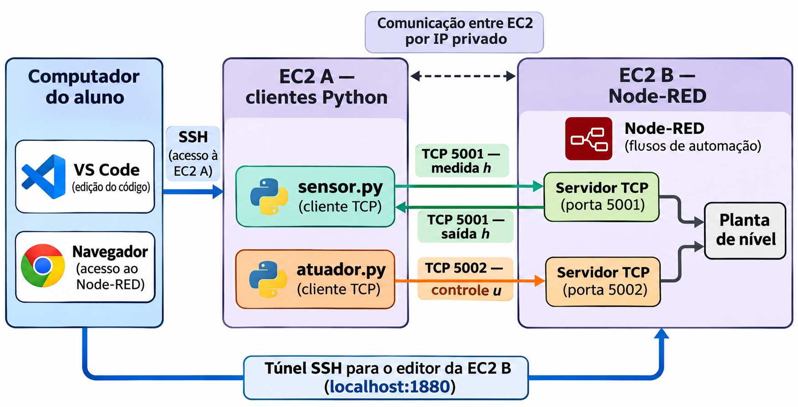
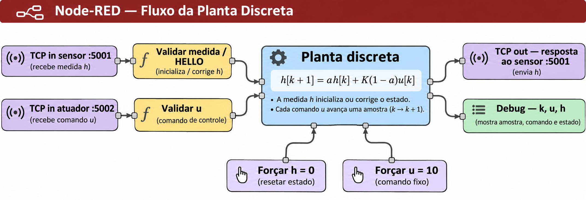
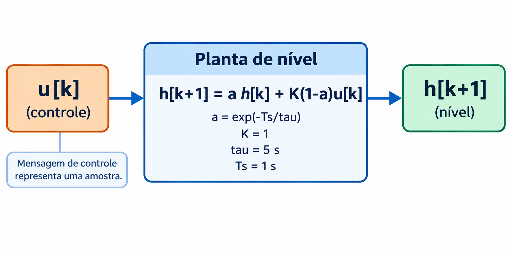

# Prática: sockets TCP, Node-RED e uma planta de nível discreta

**Curso:** Redes para Controle e Automação — Engenharia de Controle e Automação  
**Ponto de partida:** duas instâncias EC2 Ubuntu já criadas  
**Duração sugerida:** 90 a 120 minutos

## Objetivos

Ao final, você deverá conectar dois clientes Python a dois servidores TCP no Node-RED, enviar valores numéricos pelos sockets, simular uma planta de nível discreta e identificar o efeito de cada amostra do controle na saída.

## Arquitetura



Na figura, a seta de retorno `TCP 5001 — saída h` representa a saída da planta encaminhada pelo nó `tcp out` do Node-RED à conexão do `sensor.py`.

O cliente **sensor** envia uma medida de nível digitada para inicializar ou corrigir o estado `h` da planta. Ele também exibe as saídas produzidas pela planta. O cliente **atuador** envia o comando `u` (a saída de um controlador PID hipotético). Dois nós `inject` permitem forçar `h=0` ou `u=10` no editor. Cada comando de controle avança **uma amostra**; digitar lentamente não faz o modelo evoluir sozinho.

## Arquivos fornecidos

| Arquivo | Uso |
|---|---|
| `sensor.py` | Cliente TCP bidirecional: envia medidas e mostra saídas. |
| `atuador.py` | Cliente TCP: envia comandos de controle. |
| `fluxo-node-red.json` | Fluxo pronto para importar e depois examinar no editor. |
| `planta.js` | Código da função da planta, também embutido no fluxo. |
| `gerar_fluxo.py` | Regenera o JSON do fluxo se o código da planta mudar. |

Os clientes usam somente a biblioteca padrão do Python. As mensagens TCP são texto UTF-8 com `\n` no final. Use **ponto** como separador decimal: `2.5`.

## 1. Identificar as duas EC2 e preparar a rede

Anote: `IP_PUBLICO_A`, `IP_PUBLICO_B`, `IP_PRIVADO_B`, o caminho local da chave `.pem` e o grupo de segurança de cada instância. Este roteiro assume Ubuntu e as duas EC2 na mesma VPC com conectividade pelos IPs privados. Se a AMI ou a topologia forem outras, adapte o usuário SSH e a rota.

No grupo de segurança da **EC2 B**, adicione duas regras de entrada **TCP 5001** e **TCP 5002**, com origem igual ao **grupo de segurança da EC2 A**. Se não for possível usar o grupo como origem, use o IP privado da EC2 A com `/32`. Mantenha a regra SSH 22 das duas máquinas restrita ao IP público do seu computador. Para esta prática, não é necessário abrir 1880 para a internet: o editor será acessado por túnel SSH. Verifique também se as regras de saída permitem o tráfego da EC2 A para a B.

No computador local (Linux/macOS; no PowerShell os comandos SSH são equivalentes), confira a chave e teste o acesso:

```bash
chmod 400 /caminho/sua-chave.pem
ssh -i /caminho/sua-chave.pem ubuntu@IP_PUBLICO_A
```

Na EC2 A, confira a versão do Python e teste a rota para a EC2 B, depois saia do SSH:

```bash
python3 --version
ip route get IP_PRIVADO_B
exit
```

`ip route get` mostra a rota escolhida; o teste efetivo das portas será feito após iniciar o fluxo.

## 2. Conectar o VS Code à EC2 A e baixar os clientes

No VS Code do computador local, instale a extensão **Remote - SSH**. Abra a paleta (`F1` ou `Ctrl+Shift+P`) e execute **Remote-SSH: Open SSH Configuration File...**. Acrescente ao arquivo `~/.ssh/config` local:

```sshconfig
Host ec2-clientes
    HostName IP_PUBLICO_A
    User ubuntu
    IdentityFile /caminho/sua-chave.pem
    IdentitiesOnly yes
```

Execute **Remote-SSH: Connect to Host... → ec2-clientes**. Depois de conectado, abra **Terminal → New Terminal**; esse terminal já roda na EC2 A. Obtenha o código do repositório indicado pelo professor:

```bash
sudo apt update
sudo apt install -y git python3
git clone https://github.com/rafaelrezo/pratica-node-red.git pratica-node-red
cd pratica-node-red
ls sensor.py atuador.py fluxo-node-red.json
```

No VS Code, use **File → Open Folder...** e abra `~/pratica-node-red` para ler os programas. Se o diretório já existir, use `cd ~/pratica-node-red && git pull` no lugar de `git clone`.

## 3. Instalar e iniciar o Node-RED na EC2 B

No computador local, abra **outro terminal** e conecte-se à EC2 B:

```bash
ssh -i /caminho/sua-chave.pem ubuntu@IP_PUBLICO_B
```

Na EC2 B (Ubuntu), instale os pré-requisitos e rode o instalador oficial do Node-RED para Debian/Ubuntu:

```bash
sudo apt update
sudo apt install -y build-essential git curl
curl -fsSL https://github.com/node-red/linux-installers/releases/latest/download/install-update-nodered-deb -o /tmp/install-update-nodered-deb
bash /tmp/install-update-nodered-deb
node --version
npm list -g --depth=0 | grep node-red
node-red-start
```

O instalador configura o serviço. Para consultar o log depois, use `node-red-log`; para reiniciar, `node-red-restart`. Espere a indicação de que o servidor está disponível na porta 1880. Se a versão do Node.js já instalada for antiga, o instalador a atualiza conforme a versão exigida pelo Node-RED atual.

No computador local, abra **mais um terminal** e mantenha o túnel SSH ativo:

```bash
ssh -i /caminho/sua-chave.pem -N -L 1880:127.0.0.1:1880 ubuntu@IP_PUBLICO_B
```

Abra `http://localhost:1880` no navegador local. Se a porta local 1880 estiver ocupada, use `-L 1881:127.0.0.1:1880` e abra `http://localhost:1881`.

## 4. Importar e compreender o fluxo



O desenho mostra quatro caminhos lógicos de entrada. No editor, todos chegam à **única entrada** do nó `function` da planta; esse nó tem **duas saídas**. O botão `Forçar h = 0` zera o nível, mas não o contador `k`.

No editor Node-RED, abra o menu **☰ → Import → select a file**. O arquivo `fluxo-node-red.json` pode ser copiado do repositório para o computador local, ou seu conteúdo pode ser colado na aba **Clipboard** da janela de importação. Selecione **Import to new flow** e clique **Deploy**.

O fluxo contém:

1. **Servidor sensor :5001 (`tcp in`)**: servidor TCP em modo *stream*, saída como texto UTF-8, divisão das mensagens por `\n`. Seu cliente envia `HELLO` ao conectar; isso registra a sessão para o retorno. Uma medida numérica digitada inicializa/corrige `h`.
2. **Servidor atuador :5002 (`tcp in`)**: mesma configuração TCP, em outra porta. Cada número recebido é um novo `u[k]`.
3. **Forçar h = 0** e **Forçar u = 10** (`inject`): inicializam a medida ou aplicam um comando pelo editor, sem usar os respectivos clientes. Dê duplo clique para mudar um valor e depois **Deploy**.
4. **Planta de nível G(z) (`function`)**: calcula uma nova amostra e guarda o estado no contexto do fluxo.
5. **Saída ao sensor (`tcp out`)**: configurado para **Reply to TCP**, usa a sessão registrada do cliente sensor para enviar `h` de volta na porta 5001.
6. **Amostra k, u, h (`debug`)**: mostra no painel lateral as variáveis da simulação.

Se preferir criar os nós à mão, arraste dois `tcp in` em modo **Listen on**, nas portas 5001 e 5002, ambos em modo **stream of strings split on `\n`**; ligue-os às funções de validação e à função `Planta de nível G(z)`. Ligue também um `inject` numérico à planta. Configure a função com **2 saídas**, copie o conteúdo de `planta.js` para ela e ligue a primeira saída a um `tcp out` em modo **Reply to TCP** e a segunda a um `debug`. Para reproduzir o tratamento de `HELLO`, use o fluxo importado como referência das duas funções de validação.

## 5. Executar a prática

Após o **Deploy**, confirme na EC2 B que as portas escutam:

```bash
ss -ltn | grep -E ':1880|:5001|:5002'
```

No terminal remoto do VS Code (EC2 A), abra **dois terminais**, ambos em `~/pratica-node-red`. Inicie primeiro o sensor:

```bash
python3 sensor.py IP_PRIVADO_B
```

No segundo terminal, inicie o atuador:

```bash
python3 atuador.py IP_PRIVADO_B
```

No sensor, digite `0` e pressione Enter. Deve aparecer `[planta] 0.000`. No atuador, digite `10` três vezes, pressionando Enter a cada vez. O sensor deve exibir aproximadamente `1.813`, `3.297`, `4.512`. No painel **Debug**, confira `k`, `u` e `h`. Clique uma vez no botão do nó **Forçar u = 10**: a próxima saída será aproximadamente `5.507`. Digite `4` no sensor para substituir a medida e, depois, `10` no atuador: a nova saída será aproximadamente `5.088`.

As saídas esperadas acima pressupõem que o estado `h` começa em zero e que nenhuma outra amostra foi enviada no intervalo. Se repetir a prática, digite `0` no sensor para reinicializar `h`; o contador `k` continua até um novo Deploy/reinício do fluxo.

## 6. Modelo matemático e análise



Adotamos uma planta de nível simplificada de primeira ordem, com ganho `K=1`, constante de tempo `tau=5 s` e período de amostragem `Ts=1 s`:

```text
G(s) = K / (tau*s + 1)
a = exp(-Ts/tau) = exp(-0,2) ≈ 0,818730753
h[k+1] = a*h[k] + K*(1-a)*u[k]
G(z) = K*(1-a)*z^(-1) / (1-a*z^(-1))
```

O método é a discretização exata com retenção de ordem zero. Para `h[0]=0` e `u=10` constante, `h[1]≈1,813`, `h[2]≈3,297` e `h[3]≈4,512`. O modelo é didático: cada mensagem do atuador representa exatamente uma amostra de 1 s, mesmo que os Enter sejam pressionados em intervalos diferentes. Não há PID implementado nem sensor físico.

**Questões para entrega:**

1. Faça uma captura do fluxo implantado e dos terminais com três amostras de `u=10`.
2. Calcule `h[1]`, `h[2]` e `h[3]` à mão e compare com o terminal do sensor.
3. Explique por que uma nova medida digitada no sensor altera `h` sem incrementar `k`.
4. Mude `tau` para `10` em `planta.js`, regenere e importe o fluxo ou edite a função no editor, e descreva a diferença na resposta aos três primeiros comandos.
5. Descreva qual regra de grupo de segurança permite o tráfego EC2 A → EC2 B e por que a porta 1880 não precisa estar aberta publicamente.

## Diagnóstico rápido

| Sintoma | Conferir |
|---|---|
| `Connection timed out` | IP privado da EC2 B, mesma VPC/rota, entrada TCP 5001/5002 no grupo da B e saída da A. |
| `Connection refused` | Node-RED iniciado, fluxo implantado e portas escutando com `ss -ltn`. |
| Sensor não mostra retorno | Inicie `sensor.py` antes de enviar `u`; confira `HELLO`, `tcp out` em **Reply to TCP** e painel Debug. |
| Editor não abre | Túnel SSH ativo e URL `http://localhost:1880` (ou 1881); confira `node-red-log`. |
| Valor inesperado | Envie `0` no sensor, use ponto decimal e confira se não houve cliques extras no `inject`. |

## Encerrar

Digite `sair` em cada cliente, interrompa o túnel SSH com `Ctrl+C` e, se não precisar mais das instâncias, desligue-as no console da AWS conforme as orientações da disciplina.

## Fontes oficiais

- Node-RED: [instalação em Debian/Ubuntu](https://nodered.org/docs/getting-started/raspberrypi), [versões do Node.js](https://nodered.org/docs/faq/node-versions) e [execução local](https://nodered.org/docs/getting-started/local).
- VS Code: [Remote - SSH](https://code.visualstudio.com/docs/remote/ssh).
- AWS: [regras de grupos de segurança](https://docs.aws.amazon.com/vpc/latest/userguide/security-group-rules.html).
